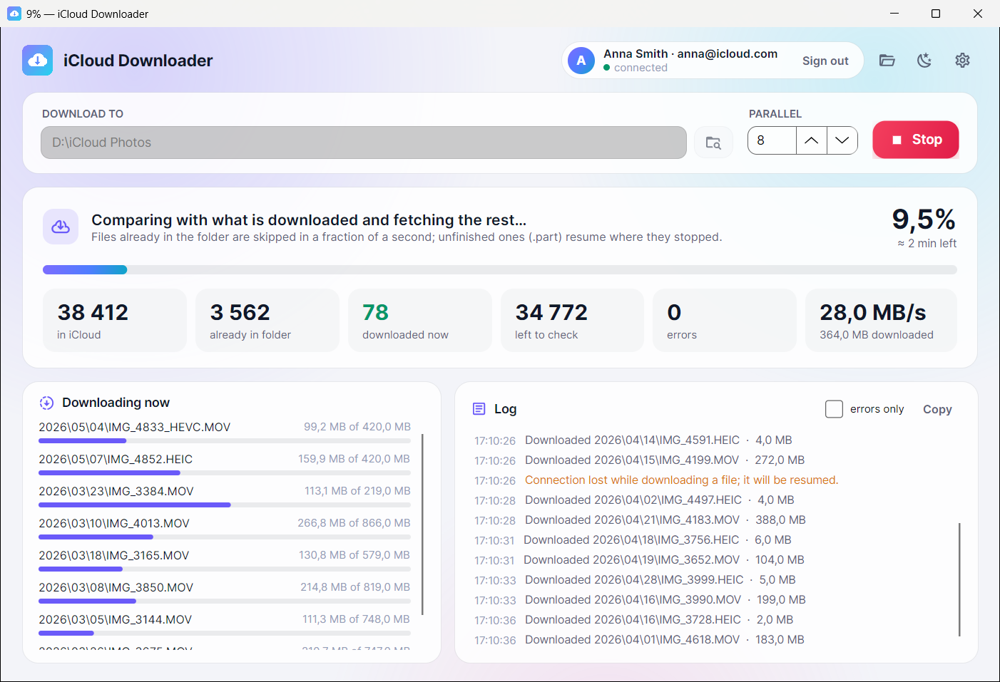
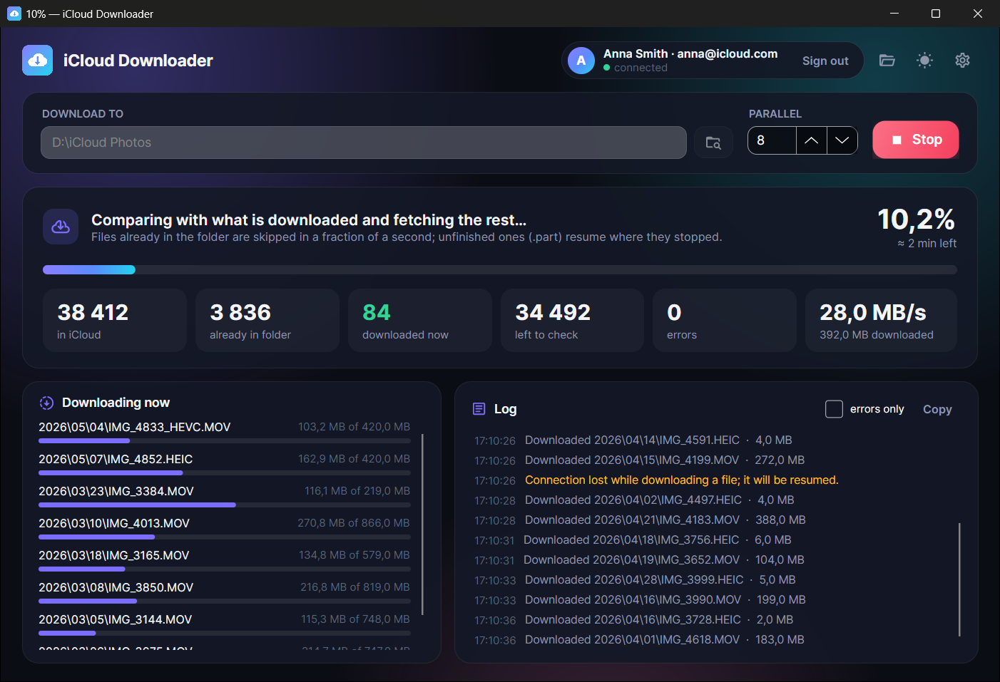
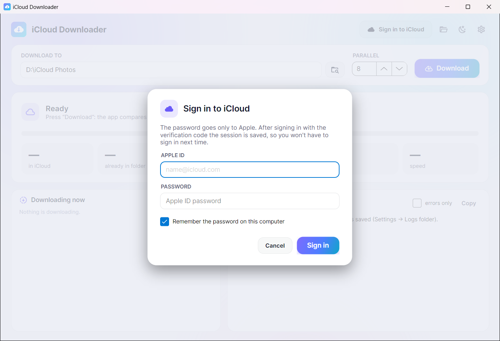
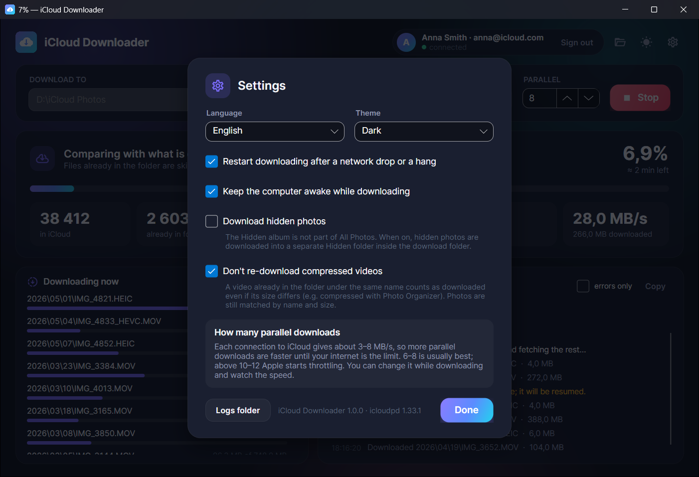

  

<h1 align="center">iCloud Downloader</h1>

  Download your whole iCloud Photos library to a folder — and see exactly what is happening. 
  Sign in once · resumes where it stopped · parallel downloads · Windows and macOS

  <a href="../../releases/latest"><b>Download for Windows and macOS</b></a>

## Why

Downloading tens of thousands of photos from iCloud with command-line tools tends to go wrong quietly: the run sits
for hours on a hidden password prompt, a dropped connection stalls it, and you can't tell what is done and what is
not. iCloud Downloader is a desktop app built on [icloudpd](https://github.com/icloud-photos-downloader/icloud_photos_downloader)
that fixes exactly that.

## Features

- **Sign in once.** Apple ID, password and the 6-digit code from your iPhone in one dialog. The session is saved
  (the password too, if you tick *Remember*, in Windows Credential Manager or the macOS Keychain), so next time
  there is nothing to type. *Sign out* removes both.
- **Never downloads a file twice.** Files already in the folder are recognised by the same names and
  `YYYY/MM/DD` folders icloudpd uses — a folder filled by icloudpd is picked up as it is. Half-downloaded files
  (`*.part`) continue from where they stopped.
- **Fast.** 1–16 parallel downloads, changeable while downloading. The library is listed 12 pages at a time,
  so checking an already-downloaded library of 45 000 photos takes a few minutes instead of 20.
- **Doesn't give up.** A file that fails is retried right away (after 5, 15 and 30 s), then again in rounds
  with growing pauses until it is downloaded. Network errors restart the run automatically; a watchdog restarts
  a run that makes no progress for 4 minutes. Photos iCloud has no original of are reported, not retried forever.
- **Backs off when Apple throttles.** When iCloud starts refusing, downloading pauses for 15 s and uses one
  parallel download less — again after every burst of refusals, until iCloud is happy. After 5 quiet minutes the
  speed comes back by itself.
- **Hidden photos too, if you want.** The *Hidden* album isn't part of *All Photos*; with *Download hidden photos*
  it goes into its own `Hidden` folder inside the download folder.
- **Fixes broken dates.** Some apps write nonsense creation dates — a 2026 video dated 1960 (Unix time where MP4
  counts from 1904), a saved image dated 1 January 1980 (the ZIP/FAT zero date). They are repaired, or replaced by
  the date the file was added to iCloud; files already downloaded under the wrong date are moved to the right one.
- **Leaves your compressed videos alone.** Shrunk your videos afterwards (e.g. with Photo Organizer) under the
  same names? With *Don't re-download compressed videos* (on by default) they still count as downloaded.
- **Shows what is going on.** Totals, files already there, downloaded now, left to check, errors, speed and time
  left; every file in flight with its own progress bar; a log with errors in plain words, an *errors only*
  filter and *Copy*.
- English and Russian, light and dark theme; keeps the computer awake while downloading.

### Dark theme

### Signing in

### Settings

## How many parallel downloads?

Each connection to iCloud gives roughly 3–8 MB/s, so more parallel downloads are faster until your internet
connection is the limit. 6–8 is usually best; above 10–12 Apple starts throttling. Change it while downloading
and watch the speed.

## Download

Get the latest version from [Releases](../../releases/latest) — nothing else to install:

| | File | How to run |
|---|---|---|
| **Windows 10/11** (x64) | `iCloudDownloader-Windows-x64.zip` | Unzip, run `iCloudDownloader.exe` (keep the `engine` folder next to it). |
| **macOS 12+** (Apple Silicon) | `iCloudDownloader-macOS-arm64.zip` | Unzip, move to Applications. Not notarized: the first time, right-click → Open. |

Releases are built by GitHub Actions ([`app-release.yml`](.github/workflows/app-release.yml)) from a tag `app-vX.Y.Z`.

## Build from source

| | You need | Run | You get |
|---|---|---|---|
| **Windows** | [Python 3.10+](https://python.org), [.NET 10 SDK](https://dot.net) | `.\build.ps1` | `iCloudDownloader.exe` on the Desktop, opened |
| **macOS** | `python3`, [.NET 10 SDK](https://dot.net) | `./build-mac.sh` | `/Applications/iCloudDownloader.app`, opened |

`.\build.ps1 -Zip` also writes the release zip to `dist\`, `./build-mac.sh --dmg` a release dmg;
`INSTALL_DIR` installs somewhere else.

`iCloudDownloader --start` begins downloading as soon as the window opens (for a shortcut or a scheduled task).

### Before the first run

iCloud must allow web access to your photos: on your iPhone, turn on
*Settings → [your name] → iCloud → Access iCloud Data on the Web*. With *Advanced Data Protection* on, this
setting is required.

## How it works

| Part | Where | What it does |
|---|---|---|
| Window | [`app/`](app) | Avalonia (.NET) app for Windows and macOS. |
| Engine | [`src/icdl_engine.py`](src/icdl_engine.py) | Signs in, lists the library in parallel, downloads with retries. Talks to the window with JSON lines: events on stdout, answers and commands such as `{"workers": 8}` on stdin. Uses icloudpd's own `download_builder`, so file names and folders match icloudpd. |
| icloudpd changes | [`session.py`](src/pyicloud_ipd/session.py), [`download.py`](src/icloudpd/download.py), [`base.py`](src/icloudpd/base.py) | Session and cookie files written under a lock (shared by threads); byte-level progress; 256 KiB reads; the reason iCloud gave is logged; optional match of videos by name alone. |

Settings, the saved session and logs live in `%APPDATA%\iCloudDownloader` (Windows) or
`~/Library/Application Support/iCloudDownloader` (macOS).

## icloudpd

This repository is a fork of [icloudpd](https://github.com/icloud-photos-downloader/icloud_photos_downloader);
the command-line tool is still here and works as before — see [README-icloudpd.md](README-icloudpd.md).

## License

MIT, like icloudpd — see [LICENSE.md](LICENSE.md).
